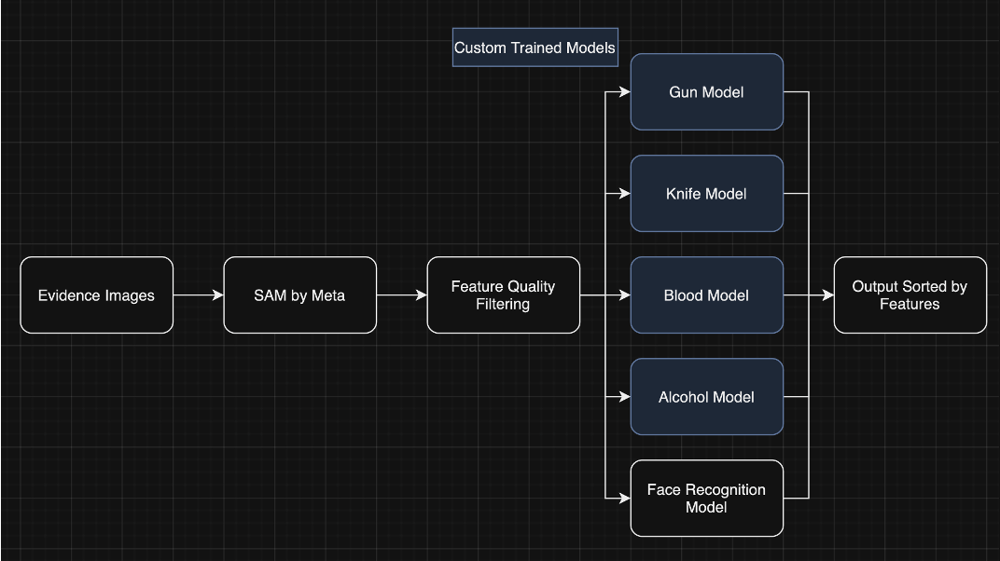

# TEMPLATE-base-repo

Create a new branch from dev, add changes on the new branch you just created.

Open a Pull Request to dev. Add your PM and TPM as reviewers. 

At the end of the semester during project wrap up open a final Pull Request to main from dev branch.

# Spring 2024 Milestone

**Team member: Ilya Bulygin, Nurassyl Medeu, Jiawei Sun, Qinghui Zhu**

## MVP

### Introduction

This folder contains complete final deliverable. Input images will be segmented, filtered, then passed into recognization model. After evaluation, output of each model will be combined and used for labeling and classification. All images will eventually be classified into different folders in ```results``` folder.

Currently supported classification types are: ```knife```, ```pistol```, ```alcohol```, ```male```, ```female```, ```asian```, ```white```, ```black```, ```blood```.

For the blood detection model, please follow the environment setting part in the blood_detection.ipynb. The files in mmdetection failed to upload to Github so it needs to be installed by code.

### Environment Requirements
- Python version: 3.11.1
- Modules requirements: requirements.txt
- To install all modules, please run ```pip install -r requirements.txt```

### Installation
```
git clone https://github.com/BU-Spark/ml-mit-evidence-analysis.git
```

### Setup
1. Clone the repo
2. Install the pre-trained models from [here](https://drive.google.com/drive/u/1/folders/1w0zNPWbahkFEmBiexCbiwHZe9Yd0uCgk)
3. Place each pre-trained model into respective folder in /ml-mit-evidence-analysis/MVP/models/[RESPECTIVE MODEL FOLDER]
4. Place input images into /ml-mit-evidence-analysis/MVP/sample_images
5. Run main.py by running ```python main.py``` in ```MVP``` folder.
6. Get model outputs in /ml-mit-evidence-analysis/MVP/sample_images/results

### Input Restriction

Currently, only ```png```, ```jpeg```, ```jpg``` image types are supported. After collecting images, put all into a folder under ```MVP``` folder for classification.

### Models

All models can be downloaded from [here](https://drive.google.com/drive/u/1/folders/1w0zNPWbahkFEmBiexCbiwHZe9Yd0uCgk)

## Project Architecture



## Proof of Concept

This folder contains all Jupyter Notebooks for individual models training.
- ```ImageSegmentation``` folder contains Segment Anything Model (**SAM**) from Meta. This model is used for input image segmentation.
- ```face_classification``` folder contains **race** and **gender** classification model.
    - Original face classificaton repo can be found here [face-classification](https://github.com/wondonghyeon/face-classification)
    - Our face classification model has modified some training codes due to python version differences. Please consider using the training code as need.
- ```selfie``` folder contains facial feature classification model.
    - This model is not embedded in the filal deliverables, since the accuracy is not ideal. Further training on different dataset may have significant improvement on the model.
- ```Blood_detection(FasterCNN).ipynb``` file aims for FasterRCNN model training on blood detection. It can work individually but have different envrionment requirement from other models. The new environment setting that is same as other model is in the MVP/blood/blood_detection.ipynb.  Original github repo can be found here [HOD-Benchmark-Dataset](https://github.com/poori-nuna/HOD-Benchmark-Dataset/tree/main)
- ```HumanCharacterModel.ipynb``` file aims for
- ```Weapon.ipynb``` file aims for **knife** and **pistol** model training. Several approaches are applied regarding high accuracy model production.
  - Self defined ```CNN``` model was selected with highest accuracy (98%), but comes with a problem of overfitting. This model is a binary detection model, without relativity percentage functionality.
  - ```YOLOv8n``` pretrained model are tesed and specialized with knife and pistol detection, but only reaches accuracy around 60%.
        - knife.yaml file for knife dataset can be found [here](https://drive.google.com/drive/u/1/folders/1qqBHAOiLvLZebG4Ss23rq30j9ELt3rKY)
        - More YOLOv8 pretrained models can be downloaded [here](https://docs.ultralytics.com/tasks/detect/#models)
  - ```MMDetection``` toolbox are utilized, with [```faster_rcnn```](https://drive.google.com/drive/u/1/folders/1qqBHAOiLvLZebG4Ss23rq30j9ELt3rKY) model tested but not spcialy trained for weapon detection. Further work can be done here with the purpose of model specialization.
- ```alcohol_model.ipynb``` file aims for **alcohol** detection. 
